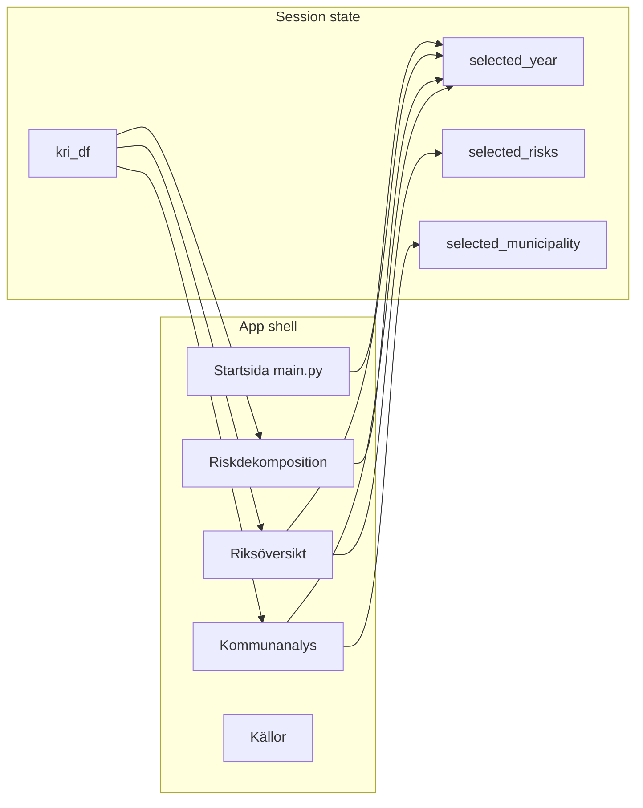

# KRI Kontrollpanel — UX/UI design system

This document is the authoritative reference for **all** user-facing visual design, layout patterns, and interaction conventions in the Kommunal Finansiell Riskindikator (KRI) Streamlit dashboard. Claims below map to concrete code paths so designers and developers can keep the product consistent.

**Canonical implementation files**

| Concern | File |
|--------|------|
| Injected CSS, HTML fragment helpers, ECharts theme helpers | `app/styles/theme.py` |
| Color tokens, typography constants, Swedish label dictionary | `src/config.py` |
| Streamlit client options | `.streamlit/config.toml` |
| ECharts option builders | `app/components/charts.py` |
| Landing weight bars + flow SVG | `app/components/landing_visuals.py` |
| Folium choropleth map | `app/components/sweden_choropleth.py` |
| Entry + landing | `app/main.py` |
| Multipage views | `app/pages/*.py` |

**Language rule (enforced in module docstrings):** all **user-facing** strings are Swedish; code identifiers, comments, and docstrings are English.

---

## 1. Introduction

### 1.1 Product identity

- **Name shown in browser:** `KRI Kontrollpanel` (`st.set_page_config` in `apply_streamlit_theme()`, `app/styles/theme.py`).
- **Visual intent:** palette and spacing follow a **banking / public-sector analytics** aesthetic: dark navy primary, restrained neutrals, gold accent for selection and emphasis, green–amber–red for risk semantics.
- **Stack:** [Streamlit](https://streamlit.io/) for layout and widgets; [Apache ECharts](https://echarts.apache.org/) via `streamlit-echarts` for charts; **Folium** + `streamlit-folium` for the Sweden choropleth; optional HTML/CSS via `st.markdown(..., unsafe_allow_html=True)`.

### 1.2 Where design lives

- **Single source of truth for colors:** `COLORS` in `src/config.py` — `app/styles/theme.py` injects these into a large `<style>` block; chart code imports the same dict.
- **Reusable HTML:** helper functions in `app/styles/theme.py` return HTML strings; pages call `st.markdown(..., unsafe_allow_html=True)`.
- **Duplicated sidebar blocks:** each page repeats the same sidebar brand + `page_link` pattern (not a shared Python function); behavior is documented here so refactors stay aligned.

---

## 2. Global application shell

### 2.1 Page configuration

In `apply_streamlit_theme()` (`app/styles/theme.py`):

- `page_title="KRI Kontrollpanel"`
- `page_icon="📊"`
- `layout="wide"`
- `initial_sidebar_state="expanded"`
- `menu_items`: `Get Help` and `Report a bug` set to `None` (hidden); `About` contains short Swedish text and data attribution.

If `set_page_config` raises `StreamlitAPIException` (e.g. navigating from another page in the same session), the exception is swallowed so multipage navigation still works.

### 2.2 Chrome visibility

Injected CSS:

- `#MainMenu` — hidden.
- `footer` — hidden.
- `header[data-testid="stHeader"]` — hidden, zero height (Streamlit header bar removed).
- `[data-testid="collapsedControl"]` — **visible**, fixed top-left, so users can expand/collapse the sidebar.

### 2.3 Main content area

- **Background:** `COLORS["bg"]` (`#F7F8FA`) on `.stApp`.
- **Text color** on main only: `COLORS["text_primary"]` applied to `[data-testid="stMain"]` and its `.block-container` (sidebar labels are styled separately so they stay light on dark).
- **Max width:** `.block-container` `max-width: 1480px` with horizontal padding `var(--kri-pad-x)` (1.5rem) and vertical `var(--kri-pad-y)` (2rem).
- **Vertical rhythm:** `[data-testid="stMain"]` and `[data-testid="stSidebar"]` have `padding-top`/`margin-top` set to 0 so main and sidebar align; first vertical block in main has `margin-top: 0` where needed.

### 2.4 Sidebar container

- **Width:** `min-width` and `width` **260px**.
- **Background:** `COLORS["primary"]` (`#0B1F3F`).
- **Border:** right border `COLORS["border"]`.
- **Content padding:** `[data-testid="stSidebarContent"]` uses the same `--kri-pad-x` / `--kri-pad-y` as main so **text keylines align** with the main column (documented in CSS comments as shared rhythm).
- **Nested `.block-container` inside sidebar:** horizontal padding stripped to avoid double gutters.

### 2.5 Streamlit configuration file

`.streamlit/config.toml`:

```toml
[client]
showSidebarNavigation = false
```

This hides Streamlit’s default multipage navigation header so only **custom** `st.sidebar.page_link` entries appear under the branded block.

---

## 3. Design tokens

### 3.1 Color palette (`src/config.py` — `COLORS`)

| Token | Hex | Role |
|-------|-----|------|
| `primary` | `#0B1F3F` | Main brand navy: sidebar, headings, KPI values, table headers underline |
| `primary_light` | `#1B2A4A` | Landing hero gradient end-stop |
| `secondary` | `#4A6FA5` | Supporting blue; landing weight bars (`.lp-weight-bar`) |
| `accent` | `#C4A35A` | Gold: eyebrows, brand bar, selected sidebar nav, chart axis pointer, step borders |
| `low_risk` | `#2E7D5B` | “Låg” risk, positive deltas when “down is good”, choropleth low end |
| `medium_risk` | `#D4A03C` | “Medel” risk |
| `high_risk` | `#B94A48` | “Hög” risk, danger KPI variant |
| `bg` | `#F7F8FA` | App background, pill backgrounds in credibility block |
| `card_bg` | `#FFFFFF` | Cards, chart background in ECharts base options |
| `text_primary` | `#1A1A2E` | Main body text |
| `text_secondary` | `#6B7280` | Subtitles, labels, secondary copy |
| `text_tertiary` | `#9CA3AF` | Meta, footnotes |
| `border` | `#EEF0F3` | Card and section borders |
| `grid` | `#E5E7EB` | Chart grid lines, map polygon stroke in Folium default styling |
| `hover` | `#F9FAFB` | HTML table row hover |

### 3.2 Diverging scale

`DIVERGING_SCALE` in `src/config.py` — list of hex colors from low KRI (green) through neutral to high KRI (red). Used by Folium `LinearColormap` in `sweden_choropleth.py` and referenced in chart logic where a continuous ramp is needed.

### 3.3 Risk class colors

`RISK_CLASS_COLORS` maps Swedish labels `"Låg"`, `"Medel"`, `"Hög"` to the same green/amber/red hex values. `get_risk_color()` / `get_risk_badge_html()` in `theme.py` use `_RISK_COLOR_MAP` (includes typo-tolerant keys like `Lag`/`Hog`).

### 3.4 Typography constants (`TYPOGRAPHY` in `src/config.py`)

Reference sizes for documentation (`font_family`, `h1_size`, `h2_size`, `body_size`, `kpi_size`, `footnote_size`). **Actual rendering** uses Google Fonts loaded in CSS (see §4).

### 3.5 CSS custom properties (`:root` in `theme.py`)

| Variable | Value | Purpose |
|----------|--------|---------|
| `--kri-pad-x` | `1.5rem` | Horizontal gutter main + sidebar |
| `--kri-pad-y` | `2rem` | Vertical padding main + sidebar |
| `--kri-label-upper` | `11px` | Uppercase micro-label size (eyebrows, KPI labels, table headers) |
| `--kri-label-track` | `1.5px` | Letter-spacing for uppercase labels |
| `--kri-brand-bar-offset` | `14px` | Left padding on landing hero eyebrow so it aligns with sidebar `.brand-mark` gold bar (4px bar + 10px gap) |
| `--kri-hero-pad-top` | `0.35rem` | Top inset inside `.lp-hero` for vertical alignment with sidebar |

---

## 4. Typography and fonts

### 4.1 Webfonts

Google Fonts link in injected CSS (`app/styles/theme.py`):

- **Source Sans Pro** — weights 300, 400, 600, 700: UI text, titles, chart `textStyle`, Folium tooltip `font-family`.
- **IBM Plex Mono** — weights 400, 500: KPI values styling context, `.card-tag`, `.kpi-delta`, numeric table cells (`.num`), sidebar pill buttons, chart **value** axes (`get_axis_style`).

### 4.2 Patterns

- **Uppercase micro-labels:** `.eyebrow`, `.kpi-label`, `.card-title` context labels, `.lp-section-title`, sidebar `.control-label`, `.nav-section` — use `--kri-label-upper` and letter-spacing.
- **Tabular numerics:** `font-variant-numeric: tabular-nums` on `.kpi-value` and `.kri-table` numeric cells.
- **Mono for data:** `.mono`, `.num` classes force IBM Plex Mono for alignment of numbers in tables and deltas.

---

## 5. Navigation and sidebar UX

### 5.1 Brand block (HTML)

Repeated on `app/main.py` and every page under `app/pages/*.py`:

- Wrapper: `.sidebar-brand` — bottom border, spacing.
- `.brand-mark` — uppercase gold label with **4×16px gold bar** via `::before` (`COLORS["accent"]`).
- `.brand-title` — white, 17px bold “Kommunal Risk”.
- `.brand-sub` — muted line “Finansiell sårbarhet · SE”.
- Section label: `.nav-section` — “Navigation”.

### 5.2 Page links

Order (when files exist):

1. `main.py` — label **Startsida**
2. `pages/riksoversikt.py` — **Riksöversikt**
3. `pages/riskdekomposition.py` — **Riskdekomposition**
4. `pages/kommunanalys.py` — **Kommunanalys**
5. `pages/kallor.py` — **Källor**

CSS (`theme.py`) styles `[data-testid="stSidebarNav"]` links: hover background, current page with gold left border and tinted background; generic `[data-testid="stSidebarContent"] a[href]` rules fix dark-on-dark Streamlit defaults for custom links.

### 5.3 Year selection (pills)

- Widget: `st.sidebar.pills` with label from `SWEDISH_LABELS["select_year"]` (“Välj år”), `label_visibility="collapsed"`, control title shown via HTML `.control-label` above.
- **Keys differ per page** (e.g. `main_year_pills`, `rv_year_pills`, `rd_year_pills`, `ka_year_pills`) to avoid collisions.

**Chip styling** (`theme.py`): sidebar buttons — semi-transparent white background, light border, IBM Plex Mono ~11px; hover brightens; **selected** (`aria-pressed="true"`) uses gold background and border with **primary navy text** for contrast.

### 5.4 Risk filter (where present)

- On **Startsida** and **Riksöversikt**: HTML block `.sidebar-control` with `.control-label` `SWEDISH_LABELS["filter_risk_class"]` and **legend rows** `.riskklass-legend` / `.riskklass-rad` with `.riskklass-punkt` circles:
  - `#2E7D5B` — Låg risk  
  - `#D4A03C` — Medel risk  
  - `#B94A48` — Hög risk  

- `st.sidebar.pills` multi-select: options `["Hög", "Medel", "Låg"]`, `selection_mode="multi"`. Empty selection means **show all** municipalities in filters (`riksoversikt.py`).

### 5.5 Sidebar footer

`.sidebar-footer` — small muted text; e.g. **KÄLLA:** SCB, Arbetsförmedlingen + “Senast uppdaterad …”. Present on **Startsida**, **Riksöversikt**, **Kommunanalys**, and **Källor**. **Riskdekomposition** uses the same brand and `page_link` list plus year pills but **does not** include this footer block (only a spacer after navigation).

---

## 6. Reusable UI components (`app/styles/theme.py`)

### 6.1 `render_page_header(eyebrow, title, subtitle, year)`

- Layout: `.page-header` — flex, space-between, bottom border.
- Left: `.eyebrow` (gold uppercase), `h1.page-title` (navy, 28px), `.page-sub` (secondary gray).
- Right: `.header-meta` — `.year-display` (large light weight year) + “Analysår” in mono uppercase.

### 6.2 `render_card_header(title, subtitle, tag)`

- `.card-header` flex row with bottom border.
- Left: `.card-title`, `.card-subtitle`.
- Right: `.card-tag` — mono uppercase pill (dataset/section label).

### 6.3 `render_kpi_card(label, value, unit, delta, delta_direction, variant, tooltip=None)`

- Container: `.kpi-card` with left accent bar `::before` (3px). Variants: `kpi-primary`, `kpi-accent`, `kpi-danger`, `kpi-success` mapping to primary, accent, high_risk, low_risk colors.
- **Label:** `.kpi-label` uppercase.
- **Value:** `.kpi-value` + optional `.kpi-unit`.
- **Delta:** `.kpi-delta` with `delta-up` / `delta-down` / `delta-flat` — green/red/gray and ▲/▼/● pseudo-elements.
- **Tooltip:** optional `title` attribute + `kpi-card--tipped` for `cursor: help` (used on Riksöversikt KPI row with long Swedish explanations).

### 6.4 Cards and tables

- **Generic card:** `.card` — white bg, border, 4px radius, padding.
- **HTML tables:** `.kri-table` — thead uppercase, navy bottom border on header row; `.num` right-aligned mono; `.rank-cell` narrow; `.kommun-name` semibold navy; row `.hover` uses `hover` token.
- **Risk pills:** `.risk-pill` with modifiers `.lag`, `.medel`, `.hog` — tinted backgrounds and borders matching risk colors; `get_risk_badge_html()` returns a single span.

### 6.5 `st.container(border=True)` (main column)

CSS targets `[data-testid="stVerticalBlockBorderWrapper"]` in main: white card background, border, radius, padding — **aligned with KPI card look**; horizontal block buttons inside can be full width.

### 6.6 Footer note

`.footer-note` — top border, flex wrap, small tertiary text; optional `code` styling for version badges (used on Riksöversikt).

---

## 7. Landing page components (`lp-*` classes)

All defined in `app/styles/theme.py` unless noted.

### 7.0 Section eyebrow — `render_landing_section_title(text)`

Returns a single `div.lp-section-title` (gold uppercase). Used internally by `render_landing_what_is_block`, `render_landing_steps`, and can be used for custom landing sections.

### 7.1 Hero — `render_landing_hero()`

- `.lp-hero`: linear gradient from `primary` → `primary_light` → deep blue; gold border; `.lp-hero-inner` max-width 720px, left-aligned.
- `.lp-eyebrow` gold; `h1.lp-headline` white, clamp 24–36px; `.lp-hero-lead` white/translucent; optional `.lp-hero-cta`.

### 7.2 Stat strip — `render_landing_stat_strip(stats)`

- `.lp-stat-strip`: CSS grid 4 columns (responsive: 2 then 1 column); connects visually under hero (`margin-top: -1`); **gold top border** (3px accent).
- `.lp-stat-cell` with borders between cells; `.lp-stat-label`, `.lp-stat-value` (mono), `.lp-stat-unit`.

### 7.3 “Vad är KRI?” — `render_landing_what_is_block()`

- `.lp-section` + `.lp-section-title` + `.lp-card-light.lp-explain-card` with `.lp-body` / `.lp-body-secondary` (max-width ~68ch).

### 7.4 Index overview block — `app/components/landing_visuals.py`

- `render_index_visual_block()`: section title “Indexet i överblick”, `.lp-card-light.lp-visual` containing:
  - **Weight bars:** `render_index_weights_html()` — `.lp-weight-row`, `.lp-weight-name`, `.lp-weight-bar-wrap`, `.lp-weight-bar` (width = percent from `WEIGHTS` in `src/config.py`), `.lp-weight-pct`.
  - **Flow SVG:** `render_index_flow_svg()` — compact diagram: five indicators → KRI box → three risk classes; uses `COLORS` for fills/strokes; `.lp-flow-svg-wrap` centers and caps max width.

### 7.5 Pipeline steps — `render_landing_steps()`

- Section title hardcoded in helper: “Så fungerar det i korthet”.
- `.lp-steps` flex row; each `.lp-step` has gold left border, hover shadow; `.lp-step-num`, `.lp-step-title` with inline SVG icons (`data` / `normalize` / `classify`); `.lp-step-text`.
- **Connectors:** `_landing_step_connector_svg()` — horizontal arrow between steps; on narrow screens CSS rotates arrow 90° (see §11).

### 7.6 Navigation cards — `render_landing_nav_card()`

- `.lp-nav-card`: min-height, gold left border, hover elevation.
- `.lp-nav-card-head` with `.lp-nav-icon` (40px box, stroke icons from `_NAV_ICONS`: map, layers, search) and `.lp-nav-tag` (often empty string on main).
- `.lp-nav-title`, `.lp-nav-desc`.

**Note:** On `app/main.py`, these cards are **visual only**; actual navigation uses the **sidebar** `page_link` list. The helper docstring mentions pairing with `st.page_link` for accessibility — the current home page does not duplicate links under each card.

### 7.7 Credibility — `render_landing_credibility()`

- `.lp-cred`: bordered card, centered; `.lp-cred-pills` with `.lp-cred-pill`; `.lp-cred-meta` for subtitle line.

---

## 8. Page-by-page layout and behavior

### 8.1 Startsida — `app/main.py`

1. `load_kri_data()` — cached parquet load; error + `st.stop()` if missing file.
2. Sidebar: brand, `page_link`s, year pills, risk pills (multi), footer; writes `session_state`: `selected_year`, `selected_risk`, `selected_risks`, `kri_df`.
3. **Hero** — `render_landing_hero` (eyebrow “Kommunal finansiell analys”, headline “Kommunal finansiell riskindikator”, lead text).
4. **Stat strip** — four cells: KRI min–max for selected year, high-risk count vs N kommuner, analysis period years, urval count.
5. **Vad är KRI?** — `render_landing_what_is_block`.
6. **Index block** — `render_index_visual_block()` from `landing_visuals.py`.
7. **Steps** — `render_landing_steps` (three steps: data, normalization, classification).
8. **Nav panel** — `st.container(border=True)` wrapping title “Vad hittar du här?” + three columns of `render_landing_nav_card` (Riksöversikt, Riskdekomposition, Kommunanalys).
9. **Credibility** — `render_landing_credibility` (SCB, Arbetsförmedlingen/Kolada, KRI v1.0).

### 8.2 Riksöversikt — `app/pages/riksoversikt.py`

- **Data:** `kri_df` from session or `_load()`; `selected_year` / `selected_risks` sync with sidebar pills; filters `filtered_df` for KPIs and map/histogram/tables.
- **Header:** `render_page_header` — eyebrow “Sida 01 · Nationell översikt”, title “Riksöversikt”, subtitle about 290 kommuner.
- **KPI row:** four `st.columns` with `render_kpi_card`: Median KRI, Högrisk kommuner, Medianskuld per capita, Befolkningsförändring — each with Swedish tooltip strings (`_KPI_TIP_*`).
- **Map + distribution:** `st.columns([1.55, 1.0])`:
  - **Left:** `st.container(border=True)` + `render_card_header` (“Geografisk fördelning”, tag “Koropletkarta”) + `render_choropleth(filtered_df, selected_year, height=440)` + expander “Om kartan”.
  - **Right:** `st.segmented_control` “Vy” — “KRI (normaliserad)” vs “Skuld per capita (rådata)”; `build_distribution_histogram` or `build_raw_indicator_histogram` + expander “Om fördelningsgrafen”.
- **Tables:** expander “Om rankningstabellerna”; two columns; each `st.container(border=True)` + `render_card_header` + HTML from `_table_html()` using `.kri-table` and `.risk-pill`.
- **Footer:** `.footer-note` with source line and `code` KRI version.

### 8.3 Riskdekomposition — `app/pages/riskdekomposition.py`

- **Header:** `render_page_header` with `SWEDISH_LABELS["risk_decomposition"]`.
- **Row 1:** columns: `st.selectbox` “Välj kommun” (sorted by rank for year); right column **inline HTML** KPI card — KRI value, risk class badge color-coded (`#2E7D5B` / `#D4A03C` / `#B94A48`), rank “av 290”.
- **Row 2:** `render_card_header` “Riskbidrag per faktor” + two columns: `build_horizontal_contribution_bar` + `build_radar` (vs rikssnitt).
- **Row 3:** `render_card_header` “Jämför kommuner” + `st.multiselect` (max 5); default list from `DEFAULT_COMPARE_MUNICIPALITIES` when present in data; `build_grouped_bars_comparison`; `st.info` if fewer than 2 kommuner selected.
- **Row 4:** `render_card_header` “KRI-trend 2010 - 2024” + `build_line_trend` (selected comparison series + “Rikssnitt”).
- **Footer:** simple attribution line (border-top, gray text).

### 8.4 Kommunanalys — `app/pages/kommunanalys.py`

- **Header:** `render_page_header` with `SWEDISH_LABELS["municipality_analysis"]`.
- **Municipality:** `st.selectbox` with `session_state` persistence key `selected_municipality`.
- **Risk strip:** flex HTML — colored pill + KRI + rank (inline styles, same hex as elsewhere).
- **Six KPIs:** `st.columns(6)` + `render_kpi_card` for KRI, rank, skuld, arbetslöshet, försörjningskvot, skattekraft (% av rikssnitt) with `_delta_info` semantics (skattekraft inverted “higher is better”).
- **Caption** explaining YoY comparison.
- **Trend:** `render_card_header` + `build_line_trend` (kommun + Rikssnitt).
- **Peer table:** `render_card_header` + `get_peer_municipalities` + `st.dataframe` with **pandas Styler** — `_highlight_extremes` applies rgba red/green tint to min/max per column (risk-aware `higher_is_worse`).
- **History table:** `render_card_header` + styled dataframe with same highlight rules.
- **Expander “Dataexport och datakvalitet”:** intro gray text; `st.download_button` CSV; `st.button` triggers PDF generation then `st.download_button` for PDF; divider; `SWEDISH_LABELS["data_quality"]`; `get_municipality_flags` warnings/success; `st.metric` trio for datapunkter; optional list of missing years per variable.

### 8.5 Källor — `app/pages/kallor.py`

- **Header:** `render_page_header` — eyebrow “KRI · …”, title “Datakällor & Metod”, subtitle about open data, **year** meta “2010–2024”.
- **Section 1:** `render_card_header` “Variabler och datakällor” + `st.dataframe(sources_df)` with `column_config` widths + footnote paragraph (100% coverage statement).
- **Section 2:** `st.expander` “API-dokumentation…” — two columns: SCB JSON example + Kolada bash example.
- **Section 3:** `render_card_header` “Licens och öppen data” + `st.dataframe(license_df)`.

---

## 9. Charts and data visualization

### 9.1 Shared ECharts theme (`theme.py`)

- `get_tooltip_style()` — white background, border, Source Sans, dashed accent axis pointer.
- `get_axis_style(axis_type)` — category vs value: value axes get dashed `splitLine` with `COLORS["grid"]`; value axis labels use IBM Plex Mono.
- `get_echarts_base_options()` — `backgroundColor: card_bg`, grid margins, animation duration 400ms, merges tooltip.

### 9.2 Builders in `app/components/charts.py`

| Function | Purpose |
|----------|---------|
| `build_distribution_histogram` | KRI score histogram, bins colored by risk zone, median line |
| `build_raw_indicator_histogram` | Raw indicator (e.g. skuld) distribution |
| `build_horizontal_contribution_bar` | Single-municipality contribution bars |
| `build_radar` | Municipality z-scores vs national average |
| `build_line_trend` | Multi-series line over years |
| `build_grouped_bars_comparison` | Grouped bars for multiple kommuner |
| `build_sweden_geo_scatter` | ECharts geo scatter for Sweden (available for map-like views; primary map UX is Folium choropleth) |

Tooltip bodies use inline CSS constants (`_TT_*` in `charts.py`) for consistent Swedish tooltip HTML in formatters.

Charts follow **Swedish** axis titles, legends, and tooltips per file docstring.

### 9.3 Choropleth — `app/components/sweden_choropleth.py`

- **Library:** Folium + `streamlit_folium.folium_static`.
- **Scale:** `branca.colormap.LinearColormap` with `DIVERGING_SCALE` and explicit stops from `_build_colormap()`: neutral grey pinned at 0, green/red breakpoints on the year's 25th/75th percentiles, domain spanning the year's actual spread. Caption “KRI Poäng · Lägre = lägre risk”. A fixed ±2.5 domain is **wrong** — the composite KRI's spread is ≈0.43σ, so it compressed all 290 municipalities into one shade.
- **Basemap:** Esri `World_Light_Gray_Base` via `src.config.MAP_TILES`; center ~ Sweden, `zoom_start=5`, `scrollWheelZoom=False`. CARTO tiles must **not** be used — `basemaps.cartocdn.com` now watermarks anonymous requests with “API KEY REQUIRED”.
- **Style:** fill from colormap; stroke `#CCCCCC` weight 0.5; highlight stroke `#1A1A2E` weight 2.
- **Tooltip:** `GeoJsonTooltip` with fields/aliases for kommun, risk, KRI, rank, skuld, unemployment, population growth, tax — **sticky** tooltips, `tooltip_css` matches card tooltip aesthetic (white, border, shadow, Source Sans).
- **Missing geo:** `st.warning` if `data/geo/kommuner.geojson` missing.

---

## 10. Formatting and microcopy

- **Integers:** `format_swedish_int()` — non-breaking space as thousands separator (`theme.py`).
- **Decimals:** pages use local `_fmt_decimal` with Swedish comma decimal and narrow no-break space as thousands separator where applicable (`main.py`, `riksoversikt.py`).
- **CSV export (kommunanalys):** `sep=";"`, `decimal=","`, UTF-8 BOM.
- **Central labels:** `SWEDISH_LABELS` in `src/config.py` for sidebar keys, page titles, KPI names, table concepts, buttons (“Ladda ner data”, etc.).

---

## 11. Responsive behavior (`theme.py` `@media`)

- **max-width 900px:** `.lp-stat-strip` → 2 columns; `.lp-steps` → column direction; `.lp-step-connector` rotates arrow; `.lp-nav-grid` → 1 column.
- **max-width 520px:** stat strip → 1 column; cells lose right border, gain bottom border; hero horizontal padding reduced.

---

## 12. Accessibility and motion

- **`prefers-reduced-motion: reduce`:** transitions disabled on `.lp-step`, `.lp-nav-card`, `.lp-step-arrow-svg`.
- **Streamlit limitations:** heavy use of `unsafe_allow_html` means screen-reader structure depends on native Streamlit widgets; decorative SVGs use `aria-hidden="true"` where set in `theme.py` / `landing_visuals.py`.
- **Folium:** map is interactive (pan/zoom); tooltips are keyboard/mouse dependent via Folium defaults.

---

## 13. Session state and information architecture

Shared keys (typical):

- `kri_df` — loaded parquet.
- `selected_year` — synced from year pills.
- `selected_risks` / `selected_risk` — risk filter (main + riksoversikt).
- `selected_municipality` — kommunanalys selectbox persistence.



---

## 14. Maintenance guidelines

1. **Prefer tokens:** change `COLORS` / `TYPOGRAPHY` in `src/config.py` first, then ensure `theme.py` still references them (no hardcoded hex in new components unless matching Folium/ECharts constraints).
2. **Single CSS injection:** global look-and-feel changes belong in `apply_streamlit_theme()`’s `<style>` block.
3. **New pages:** copy sidebar brand + `page_link` block from an existing page; apply `apply_streamlit_theme()` at top; use `render_page_header` / `render_card_header` / `render_kpi_card` for consistency.
4. **Update this document** when adding new CSS classes, chart types, or navigation entries.

---

## 15. Verification checklist (for contributors)

When changing UI, confirm:

- [ ] Colors referenced from `COLORS` where possible.
- [ ] New user-visible strings added to `SWEDISH_LABELS` or justified as proper nouns only.
- [ ] Sidebar pill keys unique per widget.
- [ ] ECharts options merge `get_echarts_base_options()` or match tooltip/grid conventions.
- [ ] Landing `lp-*` changes tested at 900px and 520px widths if layout touched.

---

*Document generated to match the repository layout and `app/styles/theme.py` as of the last documentation pass. Update alongside significant UI changes.*
